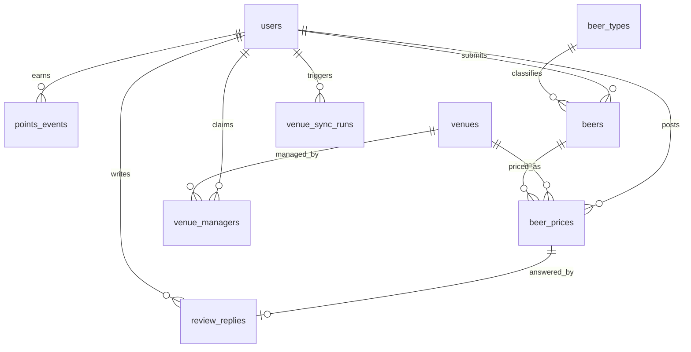

# Beercheck — Technical Specification & Implementation Blueprint

Beercheck is a mobile-first web app for finding the cheapest beer nearby. Punters post prices, photos and
reviews, publicans post official prices and reply to reviews, and admins moderate content. The venue
list comes from the NSW and VIC liquor licence registers.

This document describes what is built in this repository. The code is the source of truth. File paths
are given so each section can be checked against it.

---

## 1. Technology stack

| Concern | Choice | Notes |
|---|---|---|
| Framework | Laravel 12 on PHP 8.4 (8.3+ supported) | `composer.json` |
| Database | MariaDB 10.11+ / 11.x, driver `mariadb` | `POINT` column + `SPATIAL` index + `ST_Distance_Sphere`. SQLite is supported for tests and local dev (Haversine fallback). |
| UI | Blade + Tailwind CSS 4 + Alpine.js 3, built by Vite | Mobile-first. No SPA framework, so it works on shared hosting without Node at runtime. |
| Maps | Leaflet 1.9 + OpenStreetMap tiles | `resources/js/geo-discovery.js` |
| Geolocation | `navigator.geolocation`, falling back to Melbourne CBD `-37.8136, 144.9631` | `resources/js/location.js`, `config/beercheck.php` |
| Images | Intervention Image 3 (GD by default, Imagick if available) | `app/Services/ImageService.php` |
| Spreadsheets | OpenSpout 4 (streams CSV/XLSX, constant memory) | `app/Services/Sync/SpreadsheetFeed.php` |
| Queue / cache / sessions | `database` drivers | No Redis or supervisor needed on cPanel |
| Hosting | cPanel, Apache or LiteSpeed, `.htaccess`, one cron entry | `docs/DEPLOYMENT_CPANEL.md` |

---

## 2. Module structure

```
app/
├── Console/Commands/SyncVenues.php        app:sync-venues
├── Data/PriceFilters.php                  immutable filter DTO (lat, lng, radius, brand, type, size, price range)
├── Enums/                                 UserRole, BeerSize, BeerStatus, VenueSource, VenueManagerStatus, PointsEventType
├── Http/
│   ├── Controllers/
│   │   ├── HomeController.php             Home screen (map + list + filters)
│   │   ├── VenueController.php            nearby (JSON), search, lookup, show
│   │   ├── BeerController.php             cheapest (search + Top-3 filter), lookup, suggest
│   │   ├── BeerPriceController.php        camera/price/review submission
│   │   ├── ProfileController.php
│   │   ├── Auth/                          Register (18+ gate), Login, PasswordReset
│   │   ├── Publican/                      Claim, Dashboard, Venue profile, OfficialPrice, ReviewReply
│   │   └── Admin/                         Dashboard, Beer, PriceModeration, Venue, Claim, Sync, Points
│   ├── Middleware/                        EnsureUserHasRole (role:…), EnsureUserNotBanned
│   └── Requests/                          one FormRequest per write endpoint + GeoSearchRequest
├── Jobs/SyncVenuesJob.php                 admin-triggered sync (queued)
├── Models/                                User, Venue, VenueManager (pivot), BeerType, Beer, BeerPrice,
│                                          ReviewReply, PointsEvent, VenueSyncRun, GeocodeCache
├── Notifications/VerifyBusinessEmail.php  signed link for the publican claim
├── Policies/                              VenuePolicy@manage, BeerPricePolicy@reply
├── Rules/MinimumAge.php                   server-side 18+ check
├── Services/
│   ├── DiscoveryService.php               all geo and "current price" queries
│   ├── PointsService.php                  the only code that changes users.points
│   ├── ImageService.php                   compress + strip EXIF + store
│   ├── PriceSubmissionService.php         photo → price → points, in one transaction
│   ├── BeerModerationService.php          approve/reject (+15 points)
│   └── Sync/                              VenueFeed, SpreadsheetFeed, LicenceRecordMapper,
│                                          GeocodingService, VenueSyncService
└── Support/Geo.php                        spatial/Haversine SQL helpers
config/beercheck.php                       points, geo defaults, image, sync and geocoding settings
database/migrations/                       see §5
resources/views/                           Blade (layouts, home, venues, prices, beers, profile, publican, admin)
resources/js/                              app.js, geo-discovery.js, price-form.js, typeahead.js, location.js
routes/web.php, routes/console.php         HTTP routes and scheduler
deploy/cpanel/                             deploy.sh, public_html-index.php
tests/Feature/                             registration, prices/points, discovery, moderation/publican, sync
```

Rules followed in this layout:
- Controllers are thin. Query logic lives in `DiscoveryService` and write workflows live in services.
- Security-relevant columns (`role`, `points`, `user_id`, `is_venue_listed`, moderation fields) are
  never mass assignable. Services set them explicitly.
- Every write endpoint has its own `FormRequest`.

---

## 3. Roles & access control

| Capability | Guest | Punter | Publican | Admin |
|---|:-:|:-:|:-:|:-:|
| Browse map, search venues/beers, Top-3 filter | ✓ | ✓ | ✓ | ✓ |
| Post price / photo / rating / review (earns points) | | ✓ | ✓ | ✓ |
| Suggest a missing beer | | ✓ | ✓ | ✓ |
| Lodge a venue claim | | ✓ | ✓ | ✓ |
| Post official venue-listed price (no points) | | | own venues | all |
| Edit venue hours / phone / website / description | | | own venues | all |
| Official reply to reviews | | | own venues | all |
| Admin panel: beers, posts, venues, claims, sync, points log, bans | | | | ✓ |

How it is enforced:
- `role` is an enum column on `users`, cast to `App\Enums\UserRole`. Registration always creates a
  `punter`. The role can only change through admin claim approval or by hand in the database.
- The route middleware `role:publican,admin` and `role:admin` checks the role
  (`EnsureUserHasRole`).
- Per-venue access is checked by `VenuePolicy@manage`, which calls `User::managesVenue()`. That method
  needs an `approved` `venue_managers` row. Admins pass every check.
- `BeerPricePolicy@reply` only allows replies to punter reviews at venues the user manages.
- Banned users are logged out on their next request (`EnsureUserNotBanned`).

### Registration and the 18+ gate
- Fields: name, username (unique, `[A-Za-z0-9_.]{3,30}`), email (unique, lower-cased), optional AU
  mobile, date of birth, password (min 8, letters + numbers), and a terms checkbox.
- Client side: `<input type="date" max="{today − 18y}">`. The date uses Australia/Sydney.
- Server side: the `App\Rules\MinimumAge` rule. The DOB must be on or before today minus 18 years in
  Australia/Sydney. A person whose 18th birthday is today passes. A person who turns 18 tomorrow fails.
  These cases are tested.

### Publican verification flow
1. A signed-in user submits a claim with the venue, business name, business email and optional ABN.
   This creates a `venue_managers` row with status `pending`.
2. A temporary signed URL (valid 3 days) is emailed to the **business** email. Clicking it sets the
   status to `email_verified`.
3. An admin reviews the claim (the ABR lookup link is shown) and approves it. The user's role is
   upgraded `punter → publican`. If an admin rejects a publican's only approved venue, the user is
   demoted back to `punter`.

---

## 4. Workflows (flowchart → implementation)

| Flowchart node | Route | Controller / service |
|---|---|---|
| Home Screen | `GET /` | `HomeController` renders the shell. Alpine `geoDiscovery` gets the browser position or falls back to the CBD. |
| "beer prices and locations nearest to you" | `GET /venues/nearby?lat&lng&radius&size` (JSON) | `VenueController@nearby` → `DiscoveryService::nearbyVenues` |
| Location km radius slider (1–50 km) | slider re-queries `venues.nearby` (300 ms debounce) | radius validated with `between:1,50` |
| Filter button: brand, type, size, $5–$20 price | `GET /beers/cheapest?brand&type_id&size&min_price&max_price&radius` | `BeerController@cheapest` → `DiscoveryService::cheapest` (limit 3) |
| "top 3 cheapest beer price nearest to you" | same, JSON for XHR | sorted by price, then distance |
| Search bar → specific venue | `GET /venues/search?q=` | name/suburb LIKE, or exact postcode for 4 digits. A single match redirects to the venue. |
| Search bar → beer brand | `GET /beers/cheapest?q=` | matching approved beers → venues by cheapest current price (limit 50) |
| automatic nearest venues pop up | home list + map pins | |
| Click on venue | `GET /venues/{id}` | `VenueController@show`: metadata, distance, current prices (punter or venue-listed badge), photo/review feed with publican replies, average rating |
| `+ Post a Price` | `GET /prices/create?venue={id}` | venue pre-selected |
| Camera button → take photo → location, review, price | `GET /prices/create`, `POST /prices` | `BeerPriceController` → `PriceSubmissionService` |
| Get points when posted | inside the same DB transaction | `PointsService` |
| Upload image, review, rating, caption | same form | `review_text` doubles as the caption |

### 4.1 "Current price" semantics
Comparing every price ever posted would let one stale cheap post win forever. So each
`(venue, beer, size)` resolves to one **current price**:

1. Only rows inside the freshness window count (`BEERCHECK_PRICE_FRESHNESS_DAYS`, default 180). Rows
   must also be not flagged, not soft-deleted, and for an approved beer.
2. Among those rows, an official **venue-listed** price wins over punter posts. After that the newest
   row wins.
3. Price-range filters run **after** this ranking.

This is done with a `ROW_NUMBER()` window function, supported by MariaDB 10.2+ and SQLite 3.25+:

```sql
SELECT * FROM (
  SELECT bp.id, bp.venue_id, bp.beer_id, bp.size, bp.price, bp.is_venue_listed, bp.created_at,
         b.brand, b.name AS beer_name, b.type_id,
         ROW_NUMBER() OVER (PARTITION BY bp.venue_id, bp.beer_id, bp.size
                            ORDER BY bp.is_venue_listed DESC, bp.created_at DESC, bp.id DESC) AS rn
  FROM beer_prices bp
  JOIN beers b ON b.id = bp.beer_id
  WHERE b.status = 'approved' AND bp.deleted_at IS NULL AND bp.is_flagged = 0
    AND bp.created_at >= NOW() - INTERVAL 180 DAY
    /* partition-safe filters (venue / beer / brand / type / size) go here */
) cp WHERE cp.rn = 1
```

### 4.2 Nearby query (MariaDB spatial)
`venues.location` is a `POINT NOT NULL` with a `SPATIAL` index, stored as `POINT(longitude, latitude)`.
The query first narrows by bounding box using the R-tree index (`MBRContains`), then applies the exact
great-circle distance:

```sql
SELECT v.id, v.name, v.suburb, v.latitude, v.longitude,
       ST_Distance_Sphere(v.location, POINT(:lng, :lat)) AS distance_m
FROM venues v
WHERE v.is_active = 1
  AND MBRContains(ST_GeomFromText(:bbox_polygon), v.location)   -- uses SPATIAL index
  AND ST_Distance_Sphere(v.location, POINT(:lng, :lat)) <= :radius_m
ORDER BY distance_m
LIMIT 100;
```

`:bbox_polygon` comes from `Geo::boundingBox()` (Δlat = r/R, Δlng = r/(R·cos lat)).

The Haversine fallback is used on non-spatial drivers. It is equivalent and is also shown here for
reference:

```sql
SELECT v.*, (2 * 6371000 * ASIN(SQRT(
          POWER(SIN(RADIANS(v.latitude - :lat) / 2), 2) +
          COS(RADIANS(:lat)) * COS(RADIANS(v.latitude)) *
          POWER(SIN(RADIANS(v.longitude - :lng) / 2), 2)))) AS distance_m
FROM venues v
WHERE v.is_active = 1
  AND v.latitude  BETWEEN :minLat AND :maxLat      -- composite index (is_active, latitude, longitude)
  AND v.longitude BETWEEN :minLng AND :maxLng
HAVING distance_m <= :radius_m
ORDER BY distance_m;
```

`latitude` and `longitude` stay as `DECIMAL(10,7)` alongside `location`. The app reads and writes the
decimals. `Venue::saving()` and the sync upsert keep `location` in step with them.

### 4.3 Points engine (server side only)

| Event | Points | Condition |
|---|---:|---|
| `price_posted` | +5 | every punter price post |
| `photo_uploaded` | +5 | post includes a photo |
| `review_written` | +10 | review text ≥ 20 characters (`review_min_chars`) |
| `beer_approved` | +15 | an admin approves the user's beer suggestion |
| `moderation_reversal` | −(earned) | an admin deletes a post |

Anti-abuse rules:
- **Values come from config.** The request is never trusted for amounts. Mass assignment of `points`
  is blocked and covered by a test.
- **Atomic.** Each award runs `BEGIN → SELECT … FROM users WHERE id=? FOR UPDATE → INSERT points_events
  → UPDATE users SET points → COMMIT`. A price submission is one outer transaction: price row and all
  awards commit or roll back together. A stored photo is deleted on rollback.
- **Idempotent.** A unique index on `(user_id, event_type, reference_type, reference_id)` means the same
  contribution cannot be rewarded twice, even under a race.
- **Cooldown.** A repeat post of the same venue/beer/size by the same user within 24 h is saved but
  earns 0 points.
- **Rate limits.** Contributions are limited to 30/hour and 100/day per user.
- **Official prices earn nothing.**
- **Audit.** `users.points` always equals `SUM(points_events.points_awarded)`. Admins can review the
  ledger at `/admin/points`.

### 4.4 Image pipeline
1. **Client** (`price-form.js`): `<input type="file" accept="image/*" capture="environment">` opens the
   phone camera. The image is drawn to a canvas scaled to ≤1600 px wide, then `toBlob('image/jpeg', 0.7)`.
   The result replaces the selected file through `DataTransfer`. This saves mobile data and keeps
   uploads under shared-host upload limits.
2. **Server** (`ImageService`), which never trusts the client:
   - Validation: `image|mimes:jpg,jpeg,png,webp|max:12MB|min 200×200`.
   - Intervention `read` → auto-orient from EXIF → `scaleDown(1600, 2400)` → `toJpeg(quality: 70,
     progressive: true, strip: true)`. All metadata, including GPS, is removed.
   - Stored as `photos/YYYY/MM/{uuid}.jpg` on the `public` disk. The original upload is never kept.

### 4.5 Moderation
- **Beers:** pending → approved (+15 to the submitter, idempotent) or rejected with a reason. Admins can
  add beers directly; these are approved immediately and earn no points.
- **Posts** (price + photo + rating + review are one row): hide/unhide with a reason, remove the photo
  only, soft-delete (points are reversed), restore. Every action records `moderated_by` and
  `moderated_at`.
- **Venues:** create/edit manual venues, activate/deactivate. An admin deactivation is *sticky*
  (`deactivation_reason = 'admin'`): the licence sync will not reactivate the venue.
- **Users:** ban/unban.

---

## 5. Data model



| Table | Key columns | Indexes / constraints |
|---|---|---|
| `users` | name, username, email, mobile, date_of_birth, role enum(punter, publican, admin), avatar_url, points (unsigned int), is_banned | unique username, unique email, index role, index points |
| `venues` | name, address, suburb, state, postcode, latitude/longitude DECIMAL(10,7), **location POINT** (MariaDB), phone, website, description, opening_hours JSON, source enum(nsw_liquor, vic_liquor, manual), external_id, licence_type, is_active, deactivation_reason, deactivated_at, last_synced_at | **unique (source, external_id)**, index (name, suburb, postcode), index postcode, index (is_active, latitude, longitude), **SPATIAL (location)**, FULLTEXT (name, suburb) |
| `venue_managers` | user_id, venue_id, business_name, business_email, abn, status enum(pending, email_verified, approved, rejected), business_email_verified_at, reviewed_by, reviewed_at, admin_notes | unique (user_id, venue_id), index (venue_id, status) |
| `beer_types` | name, display_order | unique name. Seeded in the migration: Lager, Pale Ale, Ale, IPA, Stout, Porter, Wheat, Sour, Cider, Mid-strength, Other |
| `beers` | brand, name, type_id FK, abv, status enum, submitted_by FK, reviewed_by FK, reviewed_at, rejection_reason | **unique (brand, name)** (case-insensitive under `utf8mb4_unicode_ci`), index (status, brand) |
| `beer_prices` | beer_id, venue_id, user_id (FK RESTRICT), price DECIMAL(8,2), size enum(pot, schooner, pint, jug, stubby, longneck, can), is_venue_listed, photo_path, rating tinyint, review_text, is_flagged, flag_reason, moderated_by, moderated_at, **deleted_at** | index (venue_id, beer_id, size, created_at) for the window function, index (beer_id, size, price), index (user_id, created_at) |
| `review_replies` | beer_price_id FK, user_id FK, reply_text, deleted_at | unique beer_price_id (one official reply per review) |
| `points_events` | user_id, event_type, points_awarded (signed), reference_type, reference_id, created_by, note | **unique (user_id, event_type, reference_type, reference_id)** for idempotency |
| `venue_sync_runs` | source, status, dry_run, fetched / filtered / inserted / updated / deactivated / geocoded / skipped counts, error_log, triggered_by, started_at, finished_at | index (source, created_at) |
| `geocode_cache` | query_hash sha1, query, latitude, longitude, found, provider | unique query_hash |

Foreign keys that point to user content (`beer_prices.venue_id/beer_id/user_id`) use `RESTRICT`, so
history can never be cascade-deleted. Venues are deactivated, never deleted.

Migrations are in `database/migrations/`. On MariaDB, the `POINT`, `SPATIAL` and `FULLTEXT` DDL runs
through `DB::statement`. It is skipped on SQLite so tests run anywhere.

---

## 6. Liquor licence sync (`app:sync-venues`)

```
php artisan app:sync-venues                          # all enabled sources from configured URLs
php artisan app:sync-venues --source=vic_liquor --dry-run
php artisan app:sync-venues --source=nsw_liquor --file=storage/app/premises.xlsx
```

| Step | Implementation |
|---|---|
| Fetch | `SpreadsheetFeed` downloads `SYNC_NSW_URL` / `SYNC_VIC_URL` to a temp file (`Http::sink`) and streams rows with OpenSpout. It handles CSV and XLSX, skips title rows by finding the header row that contains a licence number column, and normalises headers to snake_case. |
| Map | `LicenceRecordMapper` maps each field through an alias list (e.g. `licence_number / licence_num / licence_no`, `trading_as / licence_name / premises_name`), title-cases names and checks coordinates fall inside Australia. |
| Filter | Licence type must contain no exclude keyword and at least one include keyword (`config/beercheck.php`). **NSW:** include hotel, small bar, general bar; exclude packaged, producer, wholesaler, club, restaurant, on-premises, limited. Only `Current` status is kept. **VIC:** include General, Late night (general), On-premises, Late night (on-premises); exclude packaged, producer, wholesale, club, restaurant/cafe, pre-retail, limited, BYO, remote seller. |
| Geocode | Only rows without valid coordinates are geocoded, through `GeocodingService` (Nominatim, AU-only, ≤1 req/s, identifying User-Agent, ≤500 calls per run). Results go into `geocode_cache`, keyed by the sha1 of the normalised address, so each address is looked up once. Misses are cached for 30 days. Transport errors are not cached. |
| Upsert | Batches of 500 rows, `upsert` on `(source, external_id)`. New rows are inserted active. Existing rows have their name, address, coordinates, `location`, licence type and `last_synced_at` updated. Fields publicans edit (phone, website, hours, description) are never overwritten. |
| Deactivate | After a successful run, active venues of that source whose `last_synced_at` is older than the run start get `is_active = false, deactivation_reason = 'sync_missing'`. They are **never deleted**. If one reappears in a later feed it is reactivated. Admin deactivations stay off. |
| Guard | If the feed returns fewer accepted venues than 50% of the currently active count, deactivation is skipped and logged. This protects against truncated or format-changed feeds. |
| Audit | Every run writes a `venue_sync_runs` row with counts and the error log. It is shown at `/admin/sync` and on the dashboard. |
| Schedule | `routes/console.php`: `weeklyOn(0, '02:00')->timezone('Australia/Brisbane')`. Brisbane is AEST all year with no DST, so the job is never skipped or doubled on the NSW/VIC DST changeover Sundays. `withoutOverlapping`. |
| Manual trigger | Admin → Sync → "Run now" dispatches `SyncVenuesJob`. The job is unique per source and the cron queue worker picks it up within a minute. |

Data sources: the URLs change each time the government republishes the file, so set them in `.env`.
- NSW: Liquor & Gaming NSW, *Licensed premises data* (monthly XLSX/CSV export).
- VIC: Discover Data Victoria, *Victorian liquor licences by location* (CSV resource URL).

If either publisher renames columns, add the new header to `LicenceRecordMapper::ALIASES`. If they
change licence category names, update the include/exclude keywords in `config/beercheck.php`.

---

## 7. Security and privacy
- CSRF on all forms. Session regenerated on login. Auth endpoints throttled (10/min/IP). Password reset
  does not reveal which emails exist.
- `date_of_birth` and `mobile` are `$hidden` and never shown publicly. Photos are stripped of EXIF/GPS.
- Uploaded files are re-encoded, never served as uploaded, and given a UUID filename.
- `.htaccess` blocks dotfiles and sends `nosniff`, `Referrer-Policy`, `X-Frame-Options` and a
  `Permissions-Policy` that allows geolocation and camera on self only. HTTPS is forced.
- `Model::shouldBeStrict()` is on outside production, which catches lazy loading and silently discarded
  attributes.

## 8. Testing
`php artisan test` runs 32 feature tests. They run on SQLite in memory by default. To run them against
MariaDB, export `DB_CONNECTION=mariadb DB_DATABASE=… DB_USERNAME=… DB_PASSWORD=…` first. Both have been
run and pass. Coverage:
- age gate (boundary days), role cannot be mass-assigned
- points amounts, ledger, cooldown, idempotent approval, reversal on delete
- image downscale to 1600 px JPEG
- radius and distance ordering, current-price ranking (stale vs fresh vs venue-listed), Top-3 filter,
  beer search, venue search redirect
- RBAC (admin/publican/punter), full claim flow with signed URL, publican official price and reply
  scoping
- sync: licence filtering, geocoding plus cache, upsert counts, deactivation, truncated-feed guard,
  sticky admin deactivation, dry run, schedule registration

## 9. Roadmap (not yet built)
- Email verification for punter accounts (`MustVerifyEmail`) before allowing posts.
- Punter "report this post" button feeding the moderation queue.
- Avatar upload (the `avatar_url` column exists).
- $/litre normalisation for comparing across sizes (`BeerSize::millilitres()` exists).
- Additional states (QLD, SA, WA) as new `VenueSource` cases plus config entries.

---

## 10. Brand & mobile UX

- **Brand assets** (`public/images/brand/`) are cut from the supplied logos: horizontal (dark and light
  wordmark), stacked, badge, the pin mark, and the favicon and app icons. Colours sampled from the logo
  are `beer #F7BB0E`, `gold #B27800` and `ink #201D1E` on a `foam #FFFBF0` background. Headings use
  Archivo Black; body text uses Montserrat. Both fonts are self-hosted via `@fontsource`, with no
  external font requests.
- **Mobile shell.** The top bar shows the logo plus points or Join. A bottom tab bar has Nearby,
  Search, a raised camera button (Post a price), Top 3 and Me. Inputs use 16px+ text so iOS doesn't
  zoom on focus, and the layout honours safe areas.
- **Motifs.** Charcoal "bubbles" heroes (`.bg-bubbles`), amber bands (`.bg-beer-bubbles`), a scalloped
  foam edge under heroes (`.foam-edge`), price pills, and medal emoji for the Top 3.
- **Installable.** `site.webmanifest` and icons let people "Add to Home Screen" on iOS and Android.
- **Search** is one box. It returns matching pubs (to the venue page) and matching beers (to venues
  sorted by cheapest price for that beer).

## 11. Menu spreadsheet import (Admin → Menu import)

Upload `.xlsx` / `.csv` or paste a Google Sheets link. You get a preview with row-level errors, then
confirm. Every import is logged and can be **undone** (its prices are soft-deleted). CLI:
`php artisan app:import-menu file.xlsx [--dry-run] [--punter]`.

Columns (case-insensitive, any order, title rows above the header are skipped):
`venue, suburb, postcode, venue_id, brand, beer, type, abv, size, price`.

- Venues are matched, never created. Matching uses `venue_id`, or the name plus postcode/suburb.
- Unknown beers are created as approved beers.
- Size aliases are recognised: middy, 425ml, bottle, tinnie, …
- Rows identical to a venue's current price are skipped, so re-importing an updated menu is safe.
- Imported prices are official venue prices by default, attributed to the admin who ran the import.
  They never earn points.

## 12. Staging demo content

`BEERCHECK_DEMO=true` (set by the staging deploy) shows a "STAGING · demo" banner, adds `noindex`,
and runs `php artisan app:demo-content` once. The demo content is:
- 118 **fictional** pubs scattered around real Melbourne and Sydney suburbs
- 14 demo punters and a demo publican
- about 3,000 prices in realistic ranges, with ratings, reviews and publican replies
- on-brand illustrated beer "photos" (`database/seeders/demo-photos`)

Points always match the ledger. Remove it all with `php artisan app:demo-content --remove`, or rebuild
it with `--fresh`. Demo venues use `external_id` `demo-*`, demo users use `@demo.beercheck.test`
emails, and demo users can't log in.
